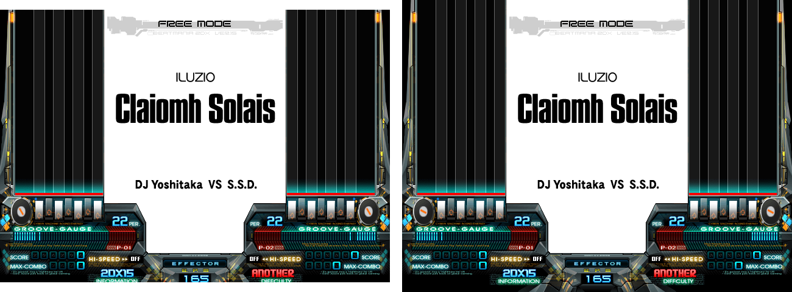

# beatmania IIDX PS2 — native 480p patch

**English** | [한국어](README.ko.md) | [日本語](README.ja.md)

Unofficial patches that make the PlayStation 2 releases of beatmania IIDX (9th style – 16 EMPRESS + PREMIUM BEST)
output **native 480p in 24-bit color** on real hardware.

The original games draw every frame at 640×480, then shrink it to 224 lines per field and output 480i.
These patches skip that step: the full image is copied 1:1 and sent out as 480p, so the picture is as sharp as the
game actually renders it. Unlike forcing 480p with GSM, nothing is line-doubled.

## Supported games

| Game | Serial | PCSX2 CRC | Redump ISO CRC32 | Redump ISO MD5 |
|---|---|---|---|---|
| beatmania IIDX 9th style | SLPM-65946 | 519805E0 | e3003130 | 48edf92aed297c7a6aad706f6aa9a948 |
| beatmania IIDX 10th style | SLPM-66180 | B308CA2F | aa317dab | d50af88cbcd5b07ed5bf5edc93084bc8 |
| beatmania IIDX 11 IIDX RED | SLPM-66426 | 98CEF49B | 594ca1ee | f329f883de48bca27b00c6bccf651be6 |
| beatmania IIDX 12 HAPPY SKY | SLPM-66621 | 6D8DB060 | 4cdcc2ed | d9b429bcc120cea14a5282112acd75f7 |
| beatmania IIDX 13 DistorteD | SLPM-66828 | 26BC121E | 3c0f9550 | 4357320bcb0933334496b2101c4ec49f |
| beatmania IIDX 14 GOLD | SLPM-66995 | 40EB926F | 1d96f650 | 5c3b5f3e31424f8ddb07d2cbaca66185 |
| beatmania IIDX 15 DJ TROOPERS | SLPM-55117 | 1393B807 | 4fa612be | 6cc843d439b8b55fee7962dd6caaae0f |
| beatmania IIDX 16 EMPRESS (Disc 1) | SLPM-55221 | 44111A43 | c4895ba7 | 30c14ab6e2de3331977fa248438dc294 |
| beatmania IIDX 16 PREMIUM BEST (Disc 2) | SLPM-55222 | 57E9E985 | cb9ad964 | b33b813bee010edbd3aa1676e03aad6c |

3rd–8th style output 240p and are not covered.

<details>
<summary>Redump ISO SHA-1</summary>

| Game | SHA-1 |
|---|---|
| 9th style | 6d42643fb992c19737b22813166a12b5d60bd69e |
| 10th style | 680edcac40ed72ed318bc1bb8d6e89224b80a330 |
| 11 IIDX RED | 8e52f963a33c9fe95022861ef39966bde715ed1a |
| 12 HAPPY SKY | b82e7939b720b8a1c0875e88a328493f336a758f |
| 13 DistorteD | 706da91072b75262729c96b16aa91181231184d2 |
| 14 GOLD | 7cc3625f57f4d77d67ac3fb3675d3ee5de18e726 |
| 15 DJ TROOPERS | 6a35e096900dc6e7842f7aa86366ba0f5fe78dfd |
| 16 EMPRESS (Disc 1) | 92d95574a6a35a908cc3255a997a15f126993ada |
| 16 PREMIUM BEST (Disc 2) | b23f9799b2cb6106b45c992928c97d6f2e4d3a8b |

</details>

## Variants

| Variant | Lines shown | Recommended for |
|---|---|---|
| **480p** (default) | 448, the same area as the original game | CRT / TVs with overscan; the in-game screen position option keeps working |
| **480p 480 lines** | all 480 rendered lines (16 more at the top and bottom) | upscalers, capture devices, displays without overscan |



*Left: 480p (448 lines). Right: 480p 480 lines.*

In the 480-line variant the in-game *vertical* screen position option has no effect (there is no spare area
left to shift); horizontal adjustment still works.

## How to apply

Use an ISO dumped from your own disc. The xdelta patches require the exact Redump-verified ISO listed above;
the script only needs the game's executable inside the ISO to be unmodified.

### xdelta (easiest)

1. Download the `.xdelta` for your game and variant from the [Releases](../../releases) page.
2. Apply it to your ISO with an xdelta patcher such as Delta Patcher or xdelta UI.

### Python script

Requires Python 3.8 or newer. The ISO is patched in place, so work on a copy.

```
python patch480p.py iso "beatmania IIDX 13 DistorteD.iso"
python patch480p.py iso "beatmania IIDX 13 DistorteD.iso" --480
```

- The game is detected automatically. Only a few dozen 4-byte words in the executable are changed;
  the ISO size and all other files stay the same.
- Running it again on a patched ISO switches between the two variants.
- If the executable is not one of the supported ones, or was changed by something else, nothing is written.

### PCSX2 (extra, for previewing and testing)

These patches are made for real hardware. PCSX2 `.pnach` files are included in each release as an extra, so the
result can be previewed or problems reproduced without touching an ISO (a patched ISO also runs in PCSX2).
PCSX2 does not show everything exactly as a real PS2 does, so please judge image quality on real hardware.

Put the files in PCSX2's `patches` folder, enable **one** of the two 480p groups in the game's properties, and boot
the game from the start (the patches change start-up code, so loading a savestate is not enough).
`python patch480p.py pnach <folder>` writes the same files.

## Using it on a real PS2

- You need a **component (YPbPr) cable** and a display, upscaler or converter that accepts 480p.
  Composite and S-Video cannot carry 480p.
- **Do not force the video mode with GSM.** The game now sets 480p by itself.
- Timing and judgement are not touched; only the video output path is changed.

## Notes

- **13, 14 and 15, opening and ending movies only:** these full-screen movies do not leave enough video memory
  for a 24-bit picture, so while they play the output switches to 16-bit with dithering, and back to 24-bit
  afterwards. Right before one of them starts, a corrupted picture may show for about one frame while the
  output switches. Everything else (menus, gameplay, song movies) is always 24-bit.
- PCSX2 does not reproduce everything the real GS does, so final checks were done on real hardware.

## How it works (short)

- The output mode is switched from 480i to 480p (`sceGsResetGraph`), and the display buffer becomes a full
  640×448 (or 640×480) 24-bit buffer instead of a 640×224 one.
- The per-frame copy from the 640×480 draw buffer is changed from a 2:1 shrink with a per-field half-line offset
  to an exact 1:1 copy with point sampling.
- To fit the bigger display buffer into the 4 MB of video memory, the draw buffer is moved to page 352 and
  (10th and later) the Z buffer is moved into the draw buffer's old place. The texture pool and the effects that
  reference these buffers directly are adjusted to match.
- 13–15 have a separate video-memory mode for full-screen movies; a small routine hooked into the game's own mode
  switch changes the output format together with it.

Every changed word is listed with a comment in [`patch480p.py`](patch480p.py).
Details: [docs/technical.md](docs/technical.md).

## Disclaimer

This is an unofficial fan project and is not affiliated with or endorsed by KONAMI or Sony Interactive
Entertainment. No game data is included or distributed; you need your own copy of the game.
Use at your own risk.

## Credits

Analysis and patches were made with the help of Claude (Anthropic).

## License

[MIT](LICENSE)
